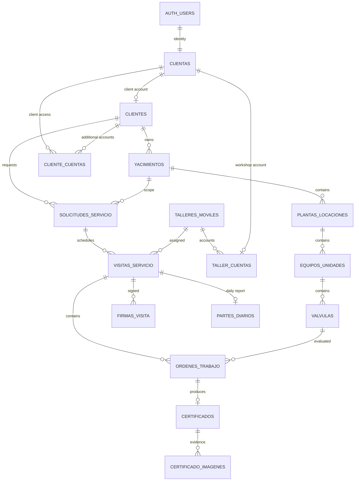

# Database schema

This document is a guide to the current database model. The executable source of truth is the ordered SQL migration history in [`supabase/migrations/`](../supabase/migrations/). The project uses one PostgreSQL schema, `public`; the sections below group tables by purpose and are not separate PostgreSQL schemas.

## Design at a glance

- `auth.users` is the authentication identity. `public.cuentas` extends it with an immutable application role and account lifecycle state.
- A `Cliente` owns `Yacimientos`; each Yacimiento contains `Plantas/locaciones`, `Equipos/unidades`, and `Válvulas`.
- A `Solicitud de servicio` holds the requested asset selection. It can have multiple `Visitas de servicio` over time. Each visit has its own `Ordenes de trabajo`.
- An evaluated work order has a certificate. Certificate history is retained; visit completion closes capture, and signatures determine whether the certificate is pending or finalized.
- Offline operations, conflicts, audit records, and file references are persisted separately from the operational records they describe.
- Application data access is mediated by authenticated Edge Functions. The browser uses Supabase Auth for sessions and does not access database tables, RPCs, or Storage directly.

## Entity relationship map

The diagram omits supporting tables and some many-to-many or history links for readability. The migration definitions contain the exact foreign keys and constraints.

## Table groups

### Accounts and access

| Table | Purpose |
| --- | --- |
| `cuentas` | Application role and account state linked to `auth.users`. |
| `clientes` | Client profile and portal settings; the primary Cliente identity is its account id. |
| `cliente_cuentas` | Associates additional account identities with a Cliente. |
| `cliente_accesos` | Restricts an additional Cliente account to selected hierarchy nodes. |
| `talleres_moviles` | System Solutions mobile workshops. |
| `taller_cuentas` | Associates the shared workshop account with a Taller Móvil. |
| `asignaciones_servicio` | Historical and active service access for a workshop at a Yacimiento. |
| `historial_relaciones` | Relationship history for service and hierarchy changes. |

### Client asset hierarchy

| Table | Purpose |
| --- | --- |
| `yacimientos` | Client-owned geographic/service area. |
| `plantas_locaciones` | Installation under a Yacimiento. |
| `equipos_unidades` | Equipment under a Planta/locación. |
| `valvulas` | Valve under an Equipo/unidad. |
| `valvula_revisiones` | Preserved technical snapshot used by a certificate. |

### Requests and field visits

| Table | Purpose |
| --- | --- |
| `solicitudes_servicio` | Canonical service request and selected asset scope; one request can have multiple visits. |
| `solicitud_valvulas` | Valve selection for a service request. |
| `visitas_servicio` | Scheduled or executed visit for a request. |
| `ordenes_trabajo` | Valve-specific work and outcome within a visit. |
| `visita_equipos` | Equipment reservation windows used to prevent simultaneous visits. |
| `partes_diarios` | Visit's daily report code. |
| `parte_diario_imagenes` | Associates daily report images with a visit and report code. |
| `dispositivos_visita` | Device identity and visit association used by field workflows. |

### Certificates and evidence

| Table | Purpose |
| --- | --- |
| `certificados` | Certificate capture, technical data, frozen asset context, and lifecycle status. |
| `certificado_imagenes` | Certificate evidence image metadata and private Storage references. |
| `imagenes_certificado` | Image/evidence records used by certificate and daily report workflows. |
| `firmas_visita` | Technician and Cliente signatures attached at visit level. |
| `contador_certificados` | Global sequence state for finalized certificate numbers. |
| `correcciones_certificado` | Authorization and lineage for a corrective certification. |
| `plantillas_certificado` | Versioned certificate field/template definition. |

### Catalogs and workshop staffing

| Table | Purpose |
| --- | --- |
| `personas` | Technician/person records. |
| `nominas_jornada` | Workshop roster for a work date. |
| `catalogo_opciones` | Configurable option lists. |
| `patrones_ensayo` | Test-standard records. |
| `replacement_catalog_versions` | Versioned replacement-parts catalog snapshots. |
| `replacement_catalog_state` | Current catalog version state. |
| `visit_catalog_downloads` | Catalog versions downloaded for offline visits. |

### Offline, audit, delivery, and administration

| Table | Purpose |
| --- | --- |
| `operaciones_sync` | Idempotent field operations submitted for synchronization. |
| `conflictos_sync` | Rejected sync operations awaiting explicit resolution. |
| `visitas_sync_ack` | Visit-level synchronization acknowledgement. |
| `registros_auditoria` | Immutable administrative and operational audit events. |
| `email_deliveries` | Transactional email delivery and resend tracking. |
| `registros_generacion_backup` | Manual backup export audit/status records. |

## Important relationships and rules

1. **Asset ownership:** ownership flows from `clientes` through `yacimientos` and down the asset hierarchy.
2. **Request and visit lifecycle:** `solicitudes_servicio` is the stable request. A later visit creates new `ordenes_trabajo`; earlier outcomes remain attached to their original visit.
3. **Certificate lifecycle:** one evaluated `orden_trabajo` can produce a certificate. A certificate captures its asset context and technical revision; closing the visit closes editing. Finalized certificate numbers are global.
4. **Offline safety:** device-generated operation ids support retries. Conflicts preserve submitted data and require an explicit administrative decision.
5. **Access boundary:** Row Level Security is enabled on application tables. The browser does not receive direct table or RPC access; the Edge Function layer performs authenticated application operations.

## Where to inspect the SQL

- Start with [`20260923000100_service_access.sql`](../supabase/migrations/20260923000100_service_access.sql) for accounts, Clients, workshops, and the asset hierarchy.
- Read `20260925000200_create_edit_service_requests.sql` and `20260925000300_schedule_assign_service_visits.sql` for request selection and visit scheduling.
- Read `20260925000400_execute_visits_and_manage_work_orders.sql` and `20260925000500_capture_certificate_drafts.sql` for field execution and certificate capture.
- Later migrations extend those foundations with certificate finalization, signatures, offline sync, access hardening, audit, catalogs, and daily reports. Apply them in timestamp order; do not run an individual later migration in isolation.

## Table currently present in the initial migration

`solicitudes_certificado` appears in the initial access-foundation migration. The later service workflow uses `solicitudes_servicio` as the canonical request table. Treat `solicitudes_servicio` as the current application model when reading the API and domain docs; check migration history before removing or repurposing the earlier table.

## Applying the schema

The schema is created by Supabase migrations, not by a generated `schema.sql`. To create a fresh local database, start the local Supabase stack and apply/reset the local database from these migrations. A reset erases local database contents. The local stack was unavailable when this guide was written, so this document describes the migration definitions and does not claim that a reset was run.
